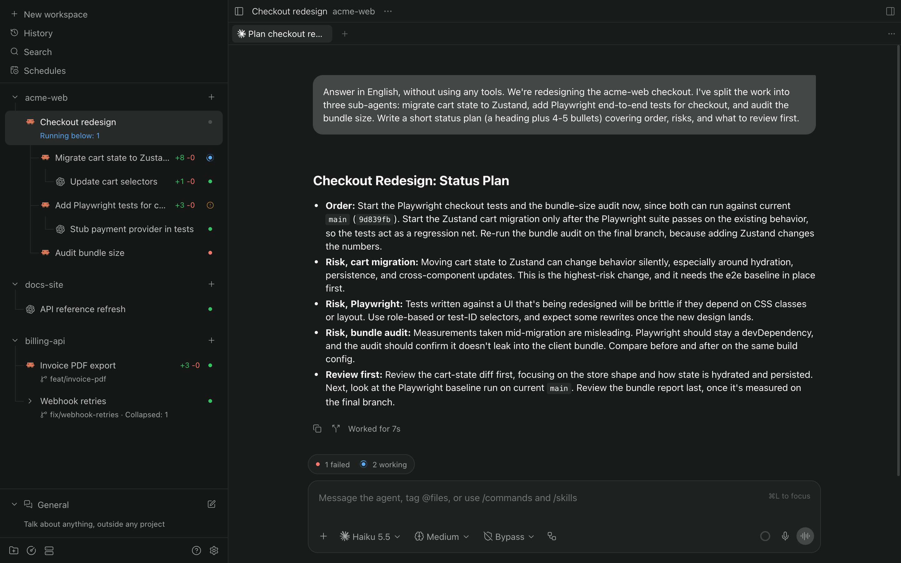

# Atrium

A Paseo plugin for working with many agents at once: an agent tree sidebar, usage cards for additional Claude and Codex accounts, and `/mcp` and `/plugins` screens for every configured agent CLI.



## Features

- **Agent tree sidebar.** Workspaces and agents as a tree built from Paseo's parent agent records; sub-agents in their own worktrees show under the agent that started them. Drag projects and sessions to reorder them (long-press menu on mobile), rename workspaces, archive sessions, remove projects, and keep project-less chats in a pinned General section.
- **Usage for additional accounts.** Cards in Paseo's usage panel for each extra Claude or Codex account configured as a Paseo provider: plan, 5-hour, weekly and model-specific limits with reset times, and local token totals.
- **MCP and plugin toolbox.** `/mcp`, `/plugins` (or `/plugin`) and Command Center items open screens to list, add and remove MCP servers and to browse, install, remove, enable, disable and update plugins for Claude Code, Codex, Antigravity and Paseo, per profile (account). Every change shows the exact command and asks for confirmation first.

The sidebar and the toolbox are available in English, Korean, Japanese, Simplified Chinese, Spanish, French, Portuguese (Brazil), Russian and Arabic.

See [OVERVIEW.md](OVERVIEW.md) for the full description.

## Requirements

- Paseo 0.16.1 or later.
- For the toolbox: the agent CLIs you want to manage (`claude`, `codex`, `agy`) and the `paseo` CLI installed on the daemon host.
- For usage cards: a Claude or Codex account configured as a Paseo provider (for example a custom provider that extends `claude` with its own `CLAUDE_CONFIG_DIR`) and logged in.

## Install

From the Paseo plugin registry, once the listing is published:

```bash
paseo plugin add mr-doosun/atrium
```

Or install directly from Git:

```bash
paseo plugin add git:Mr-DooSun/atrium
```

You can also paste either identifier into **Settings → Plugins → Plugin source** and select **Install plugin**.

Then choose **Settings → Sidebar → Sidebar view → Atrium** to use the agent tree. The usage cards and the toolbox commands work without further setup.

## Data access

Atrium runs on the daemon host with your user's permissions and sends no telemetry. In short:

- It sends each additional Claude account's OAuth token to `https://api.anthropic.com/api/oauth/usage` to read that account's limits, and downloads the public catalog from `https://plugins.paseo.sh/index.json`.
- It runs the `claude`, `codex`, `agy` and `paseo` CLIs (and, on macOS, `/usr/bin/security` to read Claude logins from the Keychain). Changes run only after you confirm.
- It reads Paseo's provider config, the additional accounts' identity, credential and session-log files, and MCP config files. It writes the sidebar order file, the `~/.paseo-chat` folder, and Antigravity's `mcp_config.json` when you change an Antigravity MCP server.

The complete list of commands, files and network requests is in [OVERVIEW.md, Data access](OVERVIEW.md#data-access). Usage details are in [docs/usage-monitor.md](docs/usage-monitor.md).

## Development

```bash
npm install
npm run typecheck
npm test
```

Tests use Node's built-in test runner (`node --import tsx --test tests/*.test.ts`) with fixtures and temporary directories.

To try a local checkout, install its absolute path on the daemon host:

```bash
paseo plugin install /absolute/path/to/atrium
```

## License

[MIT](LICENSE)
